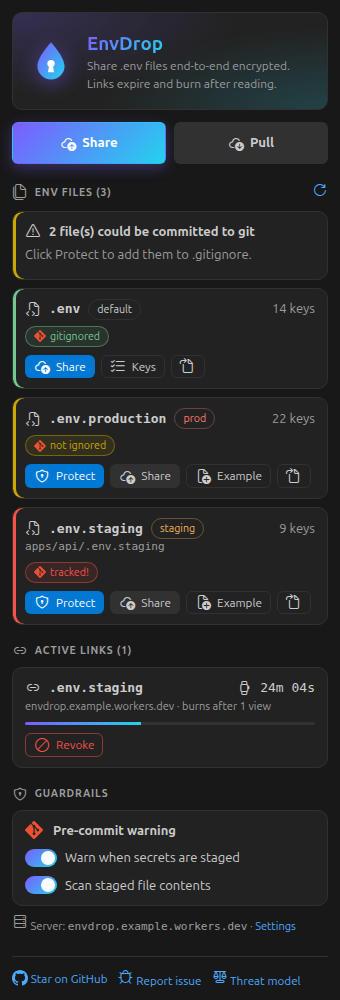
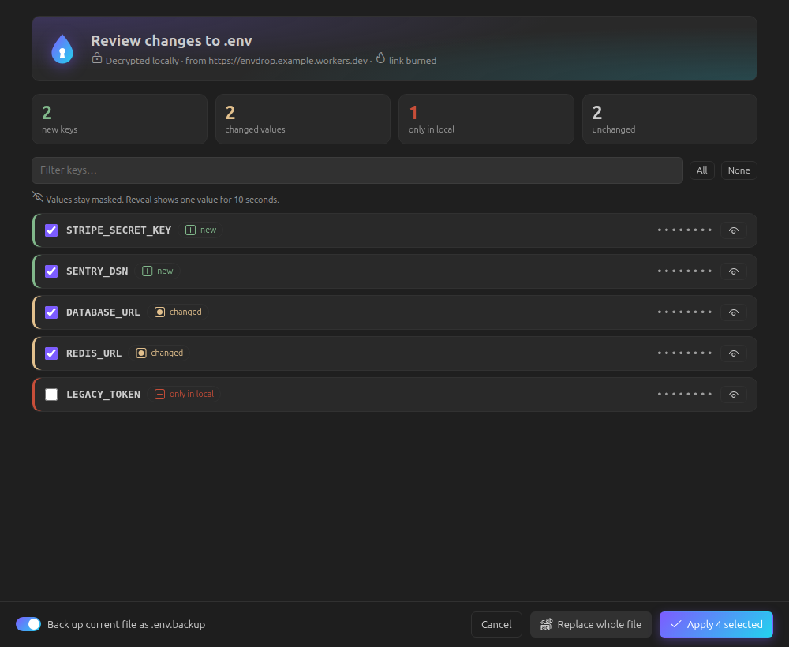

# EnvDrop

**Share `.env` files end-to-end encrypted, with expiring, burn-after-read links, right from VS Code.** Stop pasting secrets into Slack, WhatsApp or email.

- **Share .env**: one click (Command Palette, right-click a `.env` file, or the `EnvDrop` status bar item). Choose an expiry (10 min / 1 h / 24 h), a view limit (default: burn after 1 view) and an optional passphrase. The link is copied to your clipboard.
- **Pull .env**: paste the link and see a **masked, key-by-key diff** (added / changed / only-local / unchanged) before anything is written. Merge only the keys you pick, or replace the whole file. A `.env.backup` is made first, and it's gitignored.
- **.gitignore guard**: you're warned before sharing a `.env` that isn't gitignored, or that is already **tracked**. One click fixes it.
- **Staged-secret warning**: you're warned when `.env`, key files or likely secrets (AWS, GitHub, Stripe, Slack, Google, OpenAI and Anthropic keys, private keys, high-entropy `SECRET=...`) are staged. Only the file, line and a masked preview are shown.
- **Revoke link**: kill any link you created on this machine before it's used.
- **Sidebar**: every env file in the workspace with its environment and git status (Git logo chips), one-click **Protect**, live link countdowns, guardrail toggles.
- **Explorer badges and status bar**: 🔒 gitignored, `!` could be committed, `!!` tracked.
- **Generate .env.example** and **Check missing keys**: keep teammates in sync without sharing values.
- **QR code** for a link, shown only when you ask.

## How the encryption works

The file is encrypted locally with AES-256-GCM using a random 256-bit key. Only ciphertext is uploaded. The key lives in the link's `#fragment`, which is never sent to the server. With a passphrase, decryption requires both the link and the passphrase (scrypt + HKDF). The server deletes the blob after the last view or at expiry.

## Settings

- `envdrop.serverUrl`: the server used for sharing (https only). Self-hosting instructions are in the repository README.
- `envdrop.defaultExpiry`, `envdrop.defaultMaxViews`
- `envdrop.checkGitignoreOnOpen`
- `envdrop.precommit.enabled`, `envdrop.precommit.scanContent`, `envdrop.precommit.ignorePatterns`
- Add `envdrop:allow` in a comment to silence the staged-secret warning for one line.

## Threat model (short version)

**Protects against:**

- The server or its operator reading your secrets.
- Network eavesdroppers.
- Links lingering in chat history (they expire and burn).
- Tampering with stored data.
- Someone holding only the link, when you set a passphrase.
- Committing `.env` by accident.

**Does NOT protect against:**

- A compromised computer or a malicious extension on either end.
- A malicious server altering the JavaScript of the _browser fallback page_. The extension doesn't download decryption code from the server.
- A link intercepted and opened before your recipient. You'll know, because the recipient sees "already viewed".
- Weak passphrases.
- Clipboard or history capture.
- Metadata (IP, timing, approximate size).
- Secrets already pushed to git: rotate them.

The staged-secret warning is a heuristic warning inside VS Code. It is not a git hook.

EnvDrop is end-to-end encrypted with expiring links. It doesn't claim to be "100% secure". Please read the full threat model in the repository README.

## Untrusted workspaces

In Restricted Mode, EnvDrop never runs `git`: the `.gitignore` check uses a built-in parser, and the staged-secret warning is off.
